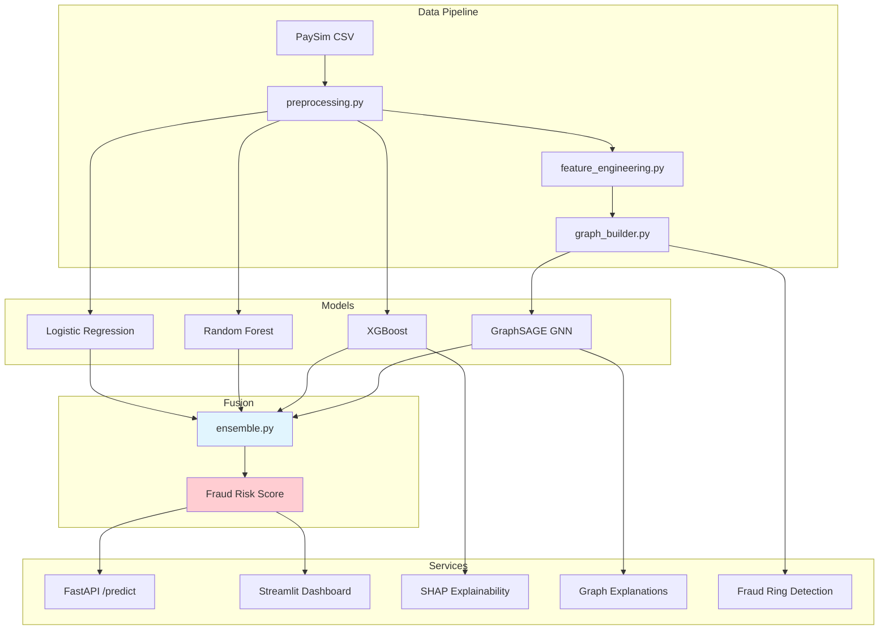

# SHIELD-AI

**UPI Fraud Detection using Ensemble Learning + Graph Neural Networks**

A production-style fraud detection framework for UPI/PaySim transactions combining Logistic Regression, Random Forest, XGBoost, and GraphSAGE (GNN) with explainability, fraud ring detection, FastAPI backend, and Streamlit dashboard.

---

## Architecture



### Ensemble Weights

| Model | Weight |
|-------|--------|
| Logistic Regression | 15% |
| Random Forest | 25% |
| XGBoost | 30% |
| GraphSAGE (GNN) | 30% |

**Decision rule:** `fraud_probability > 0.5` → **Fraud**, else **Legitimate**

---

## Project Structure

```
shield-ai/
├── data/                      # Dataset & artifacts
├── models/
│   ├── gnn_model.py           # GraphSAGE implementation
│   ├── tabular_models.py      # LR, RF, XGBoost
│   └── saved/                 # Trained model checkpoints
├── scripts/
│   ├── train.py               # Full training pipeline
│   └── evaluate.py            # Metrics & plots
├── preprocessing.py           # Phase 1: Data preprocessing + SMOTE
├── feature_engineering.py     # Phase 2: Engineered features
├── graph_builder.py           # Phase 3: NetworkX → PyG graph
├── ensemble.py                # Phase 6: Weighted fusion
├── explainability.py          # Phase 7: SHAP + graph explanations
├── fraud_ring_detection.py    # Phase 8: Cycle & community detection
├── main.py                    # Phase 9: FastAPI backend
├── dashboard.py               # Phase 10: Streamlit UI
├── config.py                  # Shared configuration
├── utils.py                   # Feature vector helpers
├── requirements.txt
└── README.md
```

---

## Quick Start

### 1. Install Dependencies

```bash
cd shield-ai
pip install -r requirements.txt
```

For PyTorch Geometric, if install fails, follow [PyG installation guide](https://pytorch-geometric.readthedocs.io/en/latest/install/installation.html).

### 2. Add PaySim Dataset (Optional)

Place `paysim.csv` in `data/paysim.csv`.  
If missing, the pipeline auto-generates synthetic PaySim-like data for demos.

Download real PaySim from [Kaggle](https://www.kaggle.com/datasets/ealaxi/paysim1).

### 3. Train Models

```bash
python scripts/train.py
# Options:
python scripts/train.py --rows 20000 --epochs 30
```

### 4. Evaluate

```bash
python scripts/evaluate.py
```

### 5. Start API Server

```bash
python main.py
# or: uvicorn main:app --reload --port 8000
```

### 6. Launch Dashboard

```bash
streamlit run dashboard.py
```

---

## API Usage

### Health Check

```bash
curl http://localhost:8000/health
```

### Predict Fraud

```bash
curl -X POST http://localhost:8000/predict \
  -H "Content-Type: application/json" \
  -d '{
    "sender": "C0001",
    "receiver": "C0137",
    "amount": 50000,
    "type": "TRANSFER"
  }'
```

**Response:**

```json
{
  "fraud_probability": 0.89,
  "prediction": "Fraud",
  "explanation": "Transaction flagged as potentially fraudulent. Key XGBoost drivers: amount (+0.42), ...",
  "risk_level": "High",
  "model_scores": {
    "logistic_regression": 0.72,
    "random_forest": 0.85,
    "xgboost": 0.91,
    "gnn": 0.88
  }
}
```

Interactive docs: `http://localhost:8000/docs`

---

## Features

### Data Preprocessing
- Missing value imputation
- Transaction type encoding (LabelEncoder)
- StandardScaler normalization
- SMOTE for class imbalance
- 80/20 stratified train-test split

### Feature Engineering
- `balance_difference_sender` / `balance_difference_receiver`
- `transaction_frequency` / `average_transaction_amount`
- `sender_out_degree` / `receiver_in_degree`

### Graph Neural Network
- **GraphSAGE** with 2 convolution layers
- Node features: degree, tx count, avg amount, fraud history
- Node-level fraud probability for sender/receiver

### Explainability
- **SHAP** values for XGBoost (top contributing features)
- **GNN**: influential neighbors, suspicious connections, transaction paths

### Fraud Ring Detection
1. Circular transactions (A → B → C → A)
2. Multi-hop fraud chains (A → B → C → D)
3. High-risk communities (NetworkX modularity)

---

## Dashboard Pages

1. **Overview** — Project summary & metrics
2. **Dataset Statistics** — PaySim EDA
3. **Fraud Prediction** — Interactive scoring
4. **Graph Visualization** — Transaction network
5. **Fraud Ring Detection** — Cycle & community analysis
6. **Model Metrics** — Precision, Recall, F1, ROC, Confusion Matrix

---

## Tech Stack

| Component | Technology |
|-----------|------------|
| Tabular ML | Scikit-Learn, XGBoost |
| Graph ML | PyTorch Geometric (GraphSAGE) |
| Graph Analysis | NetworkX |
| Imbalance | imbalanced-learn (SMOTE) |
| Explainability | SHAP |
| API | FastAPI + Uvicorn |
| Dashboard | Streamlit |

---

## Authors

Final-year mini project — **SHIELD-AI**  
*Ensemble Learning + Graph Neural Networks for UPI Fraud Detection*
